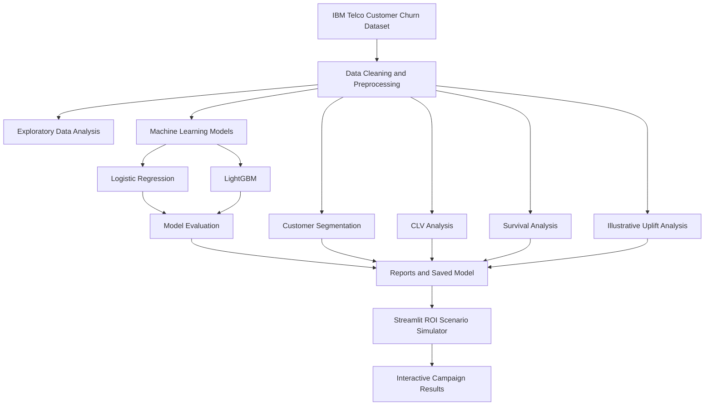

# System Architecture — Customer Lifetime Value & Churn Intelligence

## 1. Project Overview

Customer Lifetime Value & Churn Intelligence is a data science project designed to analyze customer churn, estimate customer value, identify customer segments, and explore hypothetical customer retention campaigns.

## 2. Architecture Diagram

## 3. Architecture Components

### Data Source
The project uses the IBM Telco Customer Churn dataset to analyze customer characteristics, subscription services, billing information, and churn status.

### Data Cleaning and Preprocessing
Python, Pandas, and NumPy are used to prepare the dataset for analysis and machine learning.

### Exploratory Data Analysis
Customer churn patterns and contract-related trends are analyzed to understand factors associated with customer attrition.

### Machine Learning
Logistic Regression and LightGBM are evaluated for churn classification. Performance is compared using accuracy, precision, recall, F1-score, and ROC-AUC.

### Customer Analytics
- Customer segmentation groups customers with similar characteristics.
- Customer Lifetime Value (CLV) analysis estimates customer value using project-defined assumptions.
- Survival analysis explores customer retention duration.
- Uplift analysis uses simulated treatment data and must be interpreted as illustrative rather than causal evidence.

### Reports and Model Artifacts
Generated outputs include CSV summaries, model comparison results, a SHAP feature-importance plot, and a serialized LightGBM pipeline.

### Streamlit Application
The Streamlit application lets users adjust hypothetical retention campaign assumptions and examine estimated retained customers, campaign costs, benefits, net benefits, and illustrative ROI.

## 4. Technology Stack

- **Language:** Python
- **Data processing:** Pandas, NumPy
- **Machine learning:** Scikit-learn, LightGBM
- **Visualization and explainability:** Matplotlib, SHAP
- **Survival analysis:** Lifelines
- **Web application:** Streamlit
- **Version control:** Git and GitHub
- **Deployment:** Streamlit Community Cloud

## 5. Data Flow

1. Load the source customer dataset.
2. Clean and preprocess customer data.
3. Perform exploratory data analysis.
4. Train and evaluate churn classification models.
5. Generate customer segments and CLV-related summaries.
6. Perform survival and illustrative uplift analyses.
7. Save analytical reports and model artifacts.
8. Run the Streamlit campaign scenario simulator.

## 6. Limitations

The model metrics describe performance on the project's evaluation data and do not guarantee future performance. CLV estimates depend on assumptions. Uplift analysis uses simulated treatment data, so it does not establish real-world campaign effectiveness. ROI outputs are scenario estimates, not validated business forecasts.

## 7. Project Repository

Source code, setup instructions, reports, and model artifacts are available in the project GitHub repository.

Live demo: https://customer-lifetime-value-churn-intelligence-7hb8hgkxutn7yp7jido.streamlit.app/
